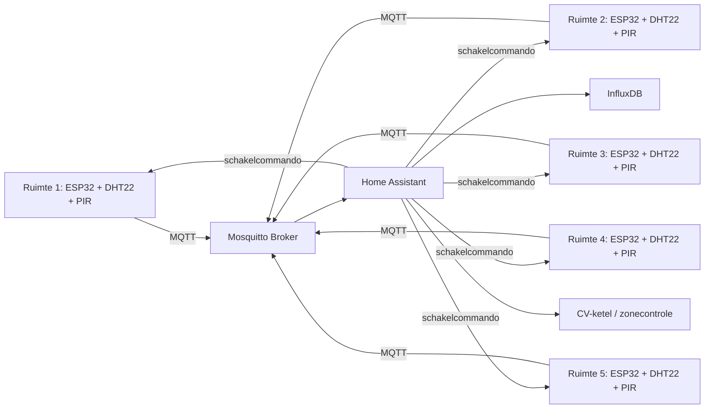

# Slimme klimaatregeling per ruimte

## Beschrijving

Dit project richt zich op een energiezuinige en slimme verwarmingsregeling voor meerdere ruimtes in een woning of klein kantoor. Het doel is om elke kamer alleen te verwarmen wanneer dat nodig is, op basis van actuele temperatuur, aanwezigheid en een vooraf ingestelde energiebesparingsstrategie.

Het systeem bestaat uit meerdere ESP32-sensor nodes, elk uitgerust met een temperatuursensor, bewegingssensor en lokaal relais. De sensoren meten continu de toestand van de ruimte en sturen deze gegevens via MQTT naar een centrale hub. Daarna verwerkt Home Assistant de informatie, toont een overzicht op een dashboard en stuurt terug aansturingen naar de juiste ruimte. Zo ontstaat een gesloten regelkring die de verwarming automatisch kan aanpassen op basis van werkelijke behoefte.

Het project is gemaakt om een bestaande CV-installatie te laten samenwerken met een slimme ruimte-eigen regeling. Hierdoor kan onnodige verwarming worden voorkomen, zonder het comfort van bewoners te verminderen. Het maakt het systeem bijzonder omdat het niet alleen temperatuur meet, maar ook aanwezigheid en locatie-aware gedrag combineert in een centrale, uitbreidbare IoT-architectuur.

### Sequence of operation

Na het opzetten van de hardware en software verloopt de werking als volgt:

1. De ESP32 node start op en maakt verbinding met het lokale WiFi-netwerk.
2. De DHT22 meet de temperatuur en luchtvochtigheid van de ruimte.
3. De PIR-sensor detecteert beweging en geeft een binaire aanwezigheidssignaal.
4. De node publiceert de metingen via MQTT naar de broker.
5. Home Assistant ontvangt de data en toont deze op het dashboard.
6. Op basis van regels voor aanwezigheid, temperatuur en tijd wordt bepaald of een ruimte verwarmd moet worden.
7. Wanneer een ruimte niet in gebruik is, stuurt Home Assistant een commando terug naar de ESP32 van die ruimte.
8. De ESP32 schakelt het relais uit en voorkomt zo onnodige warmte in die kamer.
9. Wanneer een ruimte weer in gebruik is, kan de verwarming automatisch terug worden ingeschakeld.
10. De status van alle ruimtes, sensoren en gebeurtenissen blijft zichtbaar in de grafieken en dashboards.

Deze procedure maakt het systeem geschikt voor niet-technische gebruikers die het eenvoudig willen bedienen via Home Assistant.

## Probleemstelling

De centrale uitdaging is energieverspilling door verwarming van ruimtes die niet gebruikt worden. Veel systemen laten de verwarming in een kamer doorlopen, zelfs als de ruimte leeg is. De oplossing is een slimme, per-ruimte werkende regeling die opnieuw bepaalt of de ruimte actief gebruikt wordt en of verwarming nog nodig is.

Het systeem moet daarom een gesloten regelkring vormen:

- sensoren meten temperatuur en beweging
- data wordt lokaal naar een centrale controller gestuurd
- de controller bepaalt of een ruimte verwarmd dient te worden
- een relais of interface stuurt de lokale verwarmingsaansturing aan of uit
- Home Assistant toont de status en bewaart historische data

## Systeemontwerp



### Belangrijk ontwerpprincipe

De installatie gebruikt een lokale beoordeling per kamer en een gecentraliseerde controle in Home Assistant. Er is een afzonderlijke warmtevraag per ruimte en een centrale controlemogelijkheid voor de CV-ketel. De exacte ketelintegratie moet worden uitgevoerd volgens de installatiehandleiding van de gebruikte ketel en door een bevoegde installateur, omdat een onjuiste aansluiting op de centrale verwarmingsinstallatie veiligheidsrisico's kan opleveren.

## Hardware, sensoren en actuatoren

### Edge device per ruimte

Elke ruimte krijgt een eigen sensor-node op basis van een ESP32.

- ESP32 Development Board
- DHT22 voor temperatuur en luchtvochtigheid
- HC-SR501 PIR-sensor voor beweging
- 1-kanaals relaismodule voor lokale aansturing
- Voeding volgens het gekozen ontwerp, bijvoorbeeld 5V via USB of een stabiele DC-voeding

### Centrale verwarmingsintegratie

De installatie is gekoppeld aan een Vaillant ecoTEC plus VCW 346/5-5 (E-BE) R6. De exacte interface naar de CV-ketel is afhankelijk van de installatie en het type contact en schakeling dat aanwezig is.

Belangrijk:

- De ketel mag alleen aanslaan als minimaal één ruimte warmtevraag heeft.
- Een lokaal relais is niet automatisch een veilige of correcte interface met de ketel.
- De definitieve aansluiting op de centrale verwarmingsinstallatie moet volgens de fabrikantdocumentatie en door een bevoegde vakman gebeuren.
- In de praktijk kan een geschikte zoneaansturing, een interfacekaart of een vooraf goedgekeurde schakeling nodig zijn.

## IoT-communicatie en backend

### MQTT

MQTT is gekozen als communicatieprotocool omdat het licht, betrouwbaar en ideaal is voor IoT-apparaten zoals ESP32-nodes.

Voordelen:

- laag bandbreedtegebruik
- eenvoudig te schalen naar meerdere ruimtes
- geschikt voor statusinformatie en besturing
- goed te integreren met Home Assistant

### Broker en services

De centrale backend op een Raspberry Pi 4 bevat typischerwijs:

- Mosquitto MQTT-broker
- Home Assistant voor dashboards en automations
- InfluxDB voor tijdreeksdata
- Docker Compose voor het uitvoeren van meerdere services in containers

### Voorbeeld topicstructuur

```text
home/room1/temperature
home/room1/humidity
home/room1/motion
home/room1/relay/set
home/room1/status

home/room2/temperature
home/room2/humidity
home/room2/motion
home/room2/relay/set
home/room2/status
```

Deze topics kunnen worden aangepast aan de definitieve firmwareconfiguratie.

## Dashboard, logica en actie

Het systeem gebruikt Home Assistant als gebruikersinterface en regelengine.

### Functies van het dashboard

- meten per ruimte van temperatuur en luchtvochtigheid
- status van beweging per kamer
- grafieken over tijd met InfluxDB
- relays aan/uit-status
- meldingen bij energiebesparingsmodus

### Automatiseringslogica

Typische regels zijn:

- Als een ruimte een bepaalde tijd geen beweging detecteert, wordt de ruimte als inactief beschouwd.
- Als de ruimte niet in gebruik is en de temperatuur boven het ingestelde minimum ligt, kan de verwarming worden uitgeschakeld.
- Als een ruimte weer beweging detecteert, kan het systeem opnieuw het verwarmingsbeleid evalueren.
- Als ten minste één kamer warmtevraag heeft, kan de centrale warmtevraag worden geactiveerd.
- Bij netwerkuitval, sensorfout of ongeldige data geeft het systeem een duidelijke statusmelding.

## Nice-to-haves

Om het project extra sterk te maken, kunnen de volgende uitbreidingen worden toegevoegd:

- meerdere sensornodes in vijf kamers met temperatuur- en bewegingsdata
- bidirectionele communicatie tussen ESP32 en Home Assistant
- containerisatie met Docker voor broker, dashboard en database
- historische data in InfluxDB met grafieken in Home Assistant
- veilige opslag van secrets buiten de repository
- hardware watchdog op de ESP32
- TLS voor MQTT
- seriële logging en aparte status topics zoals `/status/kamerX`

## Documentatie

Gedetailleerde documentatie is te vinden in de [docs](./docs/) map.

- [Design Document](./docs/design.md)
- [User Manual](./docs/user-manual.md)
- [Hardware documentatie](./hardware/README.md)

Voor de fysieke opzet is ook een elektrisch schema nodig dat de ESP32, DHT22, HC-SR501, relaismodule en voeding laat zien. Dit schema moet in de repository worden toegevoegd in de juiste documentatiefolder.

## Resultaten

De volgende resultaten kunnen na het testen van het systeem worden vastgelegd:

- betrouwbaarheid van de sensorwaarden per kamer
- tijdsafhankelijk gedrag van aanwezigheid en temperatuur
- energiebesparing die met het systeem is bereikt
- grafieken in Home Assistant en InfluxDB
- opstelling van de hardware en status van de centrale regelkring

## Aan de slag

Volg de onderstaande stappen om het systeem op te zetten.

### 1. Backend voorbereiden

- Installeer Docker en Docker Compose op de Raspberry Pi
- Maak een projectmap aan voor de services
- Configureer Mosquitto, Home Assistant en InfluxDB in een `docker-compose.yml`
- Zorg ervoor dat alle volumes persistent zijn

### 2. Secrets configureren

- Zet WiFi-gegevens, MQTT-credentials en andere geheimen buiten de repository
- Gebruik een lokaal secrets-bestand dat niet in Git wordt opgeslagen
- Voeg het bestand toe aan `.gitignore`

### 3. ESP32 firmware opzetten

- Installeer de Arduino IDE of PlatformIO
- Configureer de juiste WiFi SSID en wachtwoord
- Configureer MQTT-broker IP-adres, gebruikersnaam en wachtwoord
- Configureer de GPIO-pinnen voor DHT22, PIR en relais
- Upload de code naar de ESP32

### 4. Sensoren testen

- Controleer of de sensorwaarden correct worden gelezen
- Controleer de seriële output in de monitor
- Controleer of de data zichtbaar is in Home Assistant
- Controleer of de status topics correct worden gepubliceerd

### 5. Home Assistant automations

- Maak een dashboard met overzicht van alle kamers
- Configureer regels voor beweging, temperatuur en energiebesparing
- Voeg meldingen toe voor energiebesparingsmodus en fouten
- Test het systeem eerst zonder de werkelijke ketelintegratie

### 6. Veilig integratie met CV-installatie

- Controleer de installatiehandleiding van de ketel
- Laat de aansluiting op bestaande verwarmingscomponenten beoordelen door een bevoegde installateur
- Test de centrale warmtevraag alleen in een veilige en goed gecontroleerde installatie

## Discussie

### Wat werkt al?

- Hardwareconcept voor meerdere kamers is uitgewerkt
- ESP32-sensor nodes kunnen worden gebruikt voor temperatuur en aanwezigheid
- MQTT is geschikt voor communicatiemodellen in IoT
- Home Assistant kan dienen als centrale dashboard- en regelengine
- InfluxDB biedt historische data voor analyse

### Komende stappen

1. Volledige ESP32 firmware ontwikkelen en testen
2. MQTT-topics en statuslogging vastleggen
3. Home Assistant-dashboard opzetten
4. Docker omgeving voorbereiden en starten
5. Testen van de volledige gesloten regelkring
6. Integratie met de CV-ketel in een veilige opstelling

### Bekende bugs of beperkingen

- PIR-sensoren detecteren beweging, maar zijn geen perfecte aanwezigheidssensor
- WiFi- of MQTT-onderbrekingen moeten altijd veilig worden behandeld
- De exacte ketelinterface hangt af van de installatiespecificatie
- De verwarming moet op een veilige, goedgekeurde manier worden aangesloten

## Personen

- Student 1 — Hardware en elektrotechnische opbouw
- Student 2 — Firmware en ESP32-programming
- Student 3 — Backend, MQTT, Home Assistant en documentatie

## Extra opmerkingen

Het project is bedoeld als praktisch en educatief IoT-ontwerp voor slimme verwarming per ruimte. De kernidee is eenvoudig: meet wat er in een ruimte gebeurt, beslis of er warmtevraag is en schakel dan slim op basis van die informatie. De volledige realisatie vereist een goed doordachte hardware- en veiligheidsuitwerking, vooral bij de interactie met een centrale CV-installatie.

---

Dit bestand kan verder worden aangevuld met echte foto’s, meetresultaten, schematische afbeeldingen en links naar de verschillende documentatiebestanden zodra deze beschikbaar zijn in de repository.
