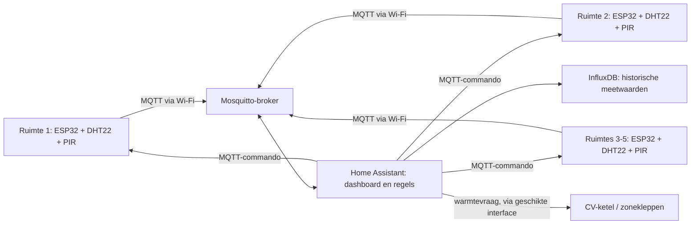

# Slimme klimaatregeling per ruimte

## Probleemstelling

Dit project onderzoekt hoe huishoudens en kleine kantoren energieverspilling kunnen beperken door ruimtes alleen te verwarmen wanneer dat nodig is. Vijf sensornodes meten per ruimte de temperatuur, luchtvochtigheid en beweging. Een centrale regelaar gebruikt deze metingen en de ingestelde voorkeuren om warmtevraag te bepalen.

Het systeem is ontworpen als een gesloten regelkring: sensordata gaat naar de centrale backend en schakelcommando's gaan terug naar de betreffende ruimte. De precieze configuratie en werking zijn afhankelijk van de uiteindelijke hardware en software die wordt opgeleverd. Deze README beschrijft het beoogde ontwerp; de genoemde onderdelen zijn niet automatisch al gerealiseerd of getest.

## Systeemontwerp



Elke kamer heeft een ESP32-edge-device. De ESP32 publiceert meetwaarden en status via MQTT. Home Assistant verwerkt de gegevens, toont de toestand van het systeem en stuurt opdrachten terug. InfluxDB kan worden gebruikt voor historische meetwaarden en grafieken.

### Beoogde regelstrategie

- Gebruik temperatuur en aanwezigheid per kamer om te bepalen of er warmtevraag is.
- Een instelbare periode zonder bewegingsdetectie (bijvoorbeeld 12 uur) kan energiebesparing activeren. Kies deze periode bewust: een PIR-sensor stelt alleen beweging vast en bewijst niet dat een ruimte leeg is.
- Laat Home Assistant de centrale warmtevraag bepalen. De ketel mag alleen warmte leveren wanneer minstens één zone dat vraagt, binnen de mogelijkheden van de bestaande installatie.
- Stel veilige minimum- en maximumtemperaturen in en zorg dat vorstbeveiliging en de bestaande ketel-/installatiebeveiligingen behouden blijven.
- Bij ontbrekende of ongeldige sensordata moet het systeem een foutstatus tonen en een vooraf bepaalde veilige toestand aannemen; vertrouw niet op een enkel PIR-signaal.

## Hardware

### Per ruimte (5 kamers)

| Onderdeel | Beoogde functie |
|---|---|
| ESP32 development board | Sensoren uitlezen, MQTT-communicatie en lokale aansturing |
| DHT22 | Temperatuur (°C) en relatieve luchtvochtigheid (%) meten |
| HC-SR501 PIR | Beweging detecteren als binaire waarde (0/1) |
| 1-kanaals relaismodule | Een geschikt zoneventiel of andere daarvoor ontworpen belasting schakelen, indien elektrisch en thermisch geschikt |

### Centrale verwarming

De installatie is beschreven als een Vaillant ecoTEC plus VCW 346/5-5 (E-BE) R6. De exacte ketelvariant, aansluitingen en compatibiliteit moeten vóór integratie worden gecontroleerd aan de hand van de officiële installatiehandleiding en door een bevoegde installateur.

De beoogde architectuur heeft lokale zoneaansturing en een centrale warmtevraag. Een interface naar de ketel kan nodig zijn, maar de aansluitklemmen en het schakelschema verschillen per installatie. Sluit een ESP32 of relais niet rechtstreeks aan op ketelaansluitingen op basis van generieke voorbeelden. Werk aan netspanning, ketelbesturing en vaste verwarmingsinstallaties moet door een bevoegde vakpersoon worden uitgevoerd. Gebruik geschikte galvanische scheiding, componenten met passende ratings en behoud alle oorspronkelijke veiligheidsvoorzieningen.

## Communicatie, backend en dashboard

- **Protocol:** MQTT over het lokale Wi-Fi-netwerk voor sensormetingen, status en opdrachten.
- **Broker:** Eclipse Mosquitto.
- **Automatisering en dashboard:** Home Assistant, bijvoorbeeld op een Raspberry Pi 4.
- **Historie:** InfluxDB voor tijdreeksen, gekoppeld aan Home Assistant voor grafieken.
- **Externe toegang:** gebruik alleen een bewust beveiligde oplossing. Stel services niet rechtstreeks bloot aan internet; Cloudflare Tunnel is een mogelijke optie, maar vereist veilige account-, toegangs- en tunnelconfiguratie.

Voorbeeld van een logische topicindeling (pas deze aan de daadwerkelijke firmwareconfiguratie aan):

```text
home/room1/temperature
home/room1/humidity
home/room1/motion
home/room1/relay/set
home/room1/status
```

De status kan bijvoorbeeld `online`, `offline` of een foutcode aangeven. Configureer MQTT-authenticatie en TLS wanneer de broker en clients correct zijn ingericht. Gebruik unieke credentials en geef clients alleen de benodigde rechten.

## Materialen en methodes

- **Edge hardware:** ESP32, DHT22, HC-SR501 en geschikte relais-/zone-interface per kamer.
- **Firmware:** Arduino/C++ voor ESP32; MQTT-client, seriële logging, foutafhandeling en watchdog.
- **Backend:** Raspberry Pi 4 met Docker Compose, Mosquitto, Home Assistant en optioneel InfluxDB.
- **Methodologie:** bouw en test eerst één laagspanningsprototype, valideer sensorwaarden en MQTT-berichten, en breid daarna gecontroleerd uit naar vijf kamers. Test automatiseringen zonder aangesloten verwarmingsactuator voordat de installatie wordt geïntegreerd.

## Aan de slag

De onderstaande stappen beschrijven de beoogde opzet. Pas ze aan zodra de configuratiebestanden en firmware in de repository beschikbaar zijn.

1. **Backend voorbereiden:** installeer Docker en Docker Compose op de Raspberry Pi en maak de benodigde configuratie en persistente opslag voor de containers aan.
2. **Secrets instellen:** configureer Wi-Fi- en MQTT-gegevens buiten de versiebeheerbestanden. Commit geen wachtwoorden, tokens, private keys of certificaten. Voeg lokale secrets-bestanden toe aan `.gitignore`.
3. **Broker en services starten:** start Mosquitto, Home Assistant en eventueel InfluxDB met de definitieve Compose-configuratie. Controleer de logs en bereikbaarheid op het lokale netwerk.
4. **Eén edge-device configureren:** vul de juiste Wi-Fi- en MQTT-instellingen lokaal in, controleer de pinconfiguratie van de sensoren en bouw/upload de firmware met de voor dit board geschikte watchdogconfiguratie.
5. **Sensoren valideren:** controleer de temperatuur in °C, luchtvochtigheid in %, PIR-status, MQTT-publicaties en online/offline-status in Home Assistant.
6. **Automatiseringen testen:** test eerst met een gesimuleerde of losgekoppelde actuator. Controleer temperatuurgrenzen, verlies van netwerkverbinding, ontbrekende meetwaarden en de energiebesparingsmelding.
7. **Opschalen:** herhaal de test voor de overige vier kamers en geef iedere node een unieke naam en topicruimte.
8. **Verwarmingsinstallatie aansluiten:** laat compatibiliteit, ketelinterface, zoneventielen en elektrische veiligheid controleren en aansluiten door een bevoegde installateur. Voer daarna een gecontroleerde functionele test uit.

## Beveiliging en betrouwbaarheid

- Bewaar geheimen lokaal; gebruik geen echte credentials in de repository. Een `secrets.h`-bestand is alleen geschikt als het aantoonbaar uit versiebeheer is gehouden; gebruik waar mogelijk een lokale configuratie of build-secrets.
- Schakel MQTT-authenticatie en TLS in waar passend en beheer certificaten veilig.
- Gebruik een ESP32-watchdog en reconnection-logica, maar behandel een herstart niet als vervanging voor foutafhandeling of veilige hardware.
- Publiceer de status van iedere node en signaleer verouderde meetwaarden in Home Assistant.
- Beperk externe toegang en gebruik sterke, unieke wachtwoorden en waar beschikbaar multi-factor-authenticatie.
- Houd ketelregelingen, vorstbeveiliging en handmatige bediening bruikbaar als de backend of Wi-Fi uitvalt.

## Documentatie

- [Documentatie en media](./docs/)
- [Hardware-overzicht](./hardware/README.md)
- [Design document](./docs/design.md) (toevoegen of bijwerken wanneer beschikbaar)
- [Gebruikershandleiding](./docs/user-manual.md) (toevoegen of bijwerken wanneer beschikbaar)

Een elektrisch schema moet de ESP32, sensoren, laagspanningsvoeding en relais-/interface duidelijk tonen. Documenteer ketel- en netspanningsaansluitingen uitsluitend volgens de modelspecifieke documentatie en laat deze door een bevoegde installateur beoordelen.

## Resultaten en demonstratie

Vul dit onderdeel aan met gemeten resultaten zodra het systeem is getest:

- Sensorafwijking en meetinterval per kamer.
- Betrouwbaarheid van MQTT-verbindingen en statusmeldingen.
- Gedrag van automatiseringen bij aanwezigheid, temperatuurwijzigingen en netwerkuitval.
- Energieverbruik vóór en na de test, indien op een betrouwbare manier gemeten.
- Afbeeldingen van het dashboard en de veilige prototype-opstelling.

Maak eventueel een demonstratievideo waarin sensormetingen, dashboardstatus en een veilige laagspanningsactuator zichtbaar zijn. Toon geen onveilige of onbevoegde werkzaamheden aan de ketel of netspanning.

## Voortgang

Werk de checklist bij op basis van daadwerkelijk uitgevoerde en geteste onderdelen.

- [ ] Probleemstelling en systeemontwerp gedocumenteerd
- [ ] Componenten en elektrisch schema gecontroleerd
- [ ] Eén ESP32-node met sensoren gevalideerd
- [ ] MQTT-communicatie en statusmeldingen getest
- [ ] Home Assistant-dashboard en automatiseringen getest
- [ ] Historische opslag met InfluxDB getest
- [ ] Vijf nodes afzonderlijk getest
- [ ] Veiligheid en ketelcompatibiliteit beoordeeld door een bevoegde installateur
- [ ] Demonstratie en resultaten toegevoegd

### Bekende aandachtspunten

- Een PIR-sensor detecteert beweging, niet aanwezigheid met absolute zekerheid.
- De ketelinterface en geschikte zoneventielen zijn afhankelijk van de concrete installatie.
- Behandel verlies van Wi-Fi, MQTT of sensordata expliciet in de automatiseringen.

## Personen

Vervang onderstaande placeholders door de projectleden en hun rollen:

- Student 1 — Hardware
- Student 2 — Firmware
- Student 3 — Backend en dashboard
